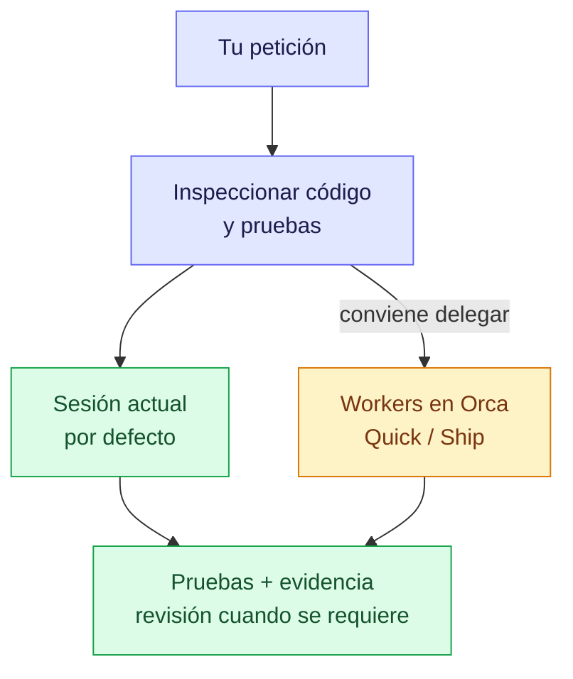
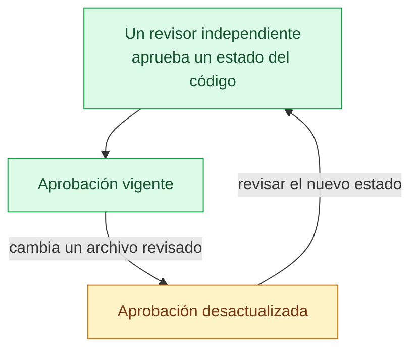

# REIN

[English](README.md) | **Español**

**De una petición de código a un cambio que puedes verificar.**

REIN ofrece a **Claude Code y Codex** un método compartido para inspeccionar un
cambio, planificar cuando hace falta, comprobar el resultado y obtener una
revisión independiente. El trabajo permanece en tu sesión actual por defecto;
**Orca** ejecuta workers delegados cuando la coordinación aporta valor.

[](https://github.com/luisfarfan/rein-agentic-kit/actions/workflows/ci.yml)
[](LICENSE)
[](pyproject.toml)
[](pyproject.toml)

[Ver un ejemplo](#una-petición-tres-decisiones-de-ingeniería-distintas) ·
[Probar una comprobación](#prueba-tres-controles-sin-iniciar-un-agente) ·
[Empezar](#empezar) · [Referencia](docs/reference.md)



**Empieza por el código. Añade el proceso que el cambio necesita.** Discover
resuelve preguntas que pueden cambiar la solución. Plan organiza requisitos y
dependencias. Audit incorpora un revisor independiente para cambios sensibles.
Quick y Ship permiten delegar explícitamente mediante Orca.

## Qué cambia en la práctica

| Problema a resolver | Qué aporta REIN | Qué puedes inspeccionar |
| --- | --- | --- |
| Una petición oculta comportamiento existente o impacto en consumidores | Inspeccionar código, pruebas, productores y consumidores antes de elegir la solución | Hallazgos, incertidumbres y un cambio delimitado |
| Es difícil definir cuándo está terminado | Tareas con criterios de aceptación, dependencias, repositorio y comando de verificación | Un plan con una comprobación para cada tarea |
| Una comprobación falló o nunca llegó a ejecutarse | Gates deterministas que distinguen éxito, fallo y problemas de entorno | Códigos de salida, salida de comandos y registros de los gates |
| Una aprobación es anterior a las últimas ediciones | Veredictos vinculados a hashes de los archivos revisados | La aprobación pierde vigencia al cambiar esos archivos |
| El trabajo delegado necesita coordinación | Dependencias, estado guardado, reintentos acotados y decisiones del usuario | Ejecuciones recuperables en Orca y preguntas pendientes visibles |

## Una petición, tres decisiones de ingeniería distintas

> **«Agrega soporte para EUR».**

La misma petición necesita trabajo distinto según el código. En la
[evaluación de la política de entrada](docs/research/2026-11-01-entry/RESULTS.md)
registrada en este repositorio, sesiones con la guía de REIN inspeccionaron tres
fixtures de desarrollo:

| Qué encontró la inspección | Qué hizo la sesión | Por qué importa |
| --- | --- | --- |
| EUR ya funcionaba; la configuración lo deshabilitaba | Cambió la configuración y añadió una prueba de regresión persistente | Reutilizó una capacidad existente |
| El checkout llegaba a un ledger que solo almacenaba USD | Conservó EUR deshabilitado y añadió una protección; el soporte completo y la revisión independiente quedaron pendientes | Expuso una invariante monetaria antes de afirmar que existía soporte |
| Faltaba el contrato del proveedor real | Probó el límite conocido y dejó el soporte real de EUR como UNKNOWN | Identificó la evidencia necesaria para continuar |

El informe incluye las comprobaciones de los fixtures y el trabajo pendiente.
El control nativo sencillo también completó su cambio; estos casos acotados
muestran comportamiento observado, sin establecer superioridad general frente
a una sesión sin esa guía.

## Prueba tres controles sin iniciar un agente

Desde este checkout, con Python 3.9 o superior, ejecuta:

```sh
python3 -m unittest -v \
  tests.test_gate_decision.DecideGateTestCase.test_nothing_ran_is_never_green \
  tests.test_gate_decision.DecideGateTestCase.test_uninvocable_test_is_setup_not_red \
  tests.test_gate.TestCheckReview.test_editing_a_reviewed_file_makes_the_approval_stale
```

**Resultado esperado: tres pruebas correctas.** Demuestran que un gate vacío no
puede pasar, que la ausencia de una herramienta se informa como problema de
entorno y que una edición invalida la aprobación del estado anterior. Usan
fixtures temporales y no requieren una llamada al modelo ni un worker de Orca.

## Cómo se mantiene vigente una revisión



El método requiere revisión para cambios en seguridad, permisos, dinero,
persistencia, concurrencia o contratos entre servicios. Un hallazgo bloqueante
necesita un defecto confirmado y evidencia. El revisor debe ser independiente
del implementador. La auditoría puede omitir defectos; la aprobación se limita
al estado y al alcance revisados.

## Qué ejecuta cada parte

| Parte | Responsabilidad |
| --- | --- |
| **Tu sesión de Claude Code o Codex** | Inspeccionar la tarea, razonar sobre el impacto, elegir las skills útiles y normalmente implementar en la sesión actual |
| **Skills de REIN** | Guiar investigación, planificación, límites de implementación, revisión y delegación |
| **CLI de REIN** | Resolver comandos, comprobar planes, ejecutar gates, validar vigencia de evidencia, registrar revisiones y coordinar trabajo delegado |
| **Orca, al delegar** | Ejecutar workers y gestionar sus worktrees, terminales, observaciones de cuentas y gates de decisión |

Discover explícito solo investiga. Plan muestra el borrador antes de escribir.
Quick delega un cambio pequeño cuando lo solicitas. Ship coordina un plan cuando
el paralelismo o la recuperación lo justifican. Answer y Watch devuelven las
decisiones a la sesión que inició el trabajo. [Detalle operativo](docs/reference.md).

## Empezar

### 1. Exponer las skills a tu agente

Para Claude Code, desde el marketplace:

```sh
claude plugin marketplace add luisfarfan/rein-agentic-kit
claude plugin install rein@rein-agentic-kit --scope project
```

Para actualizar esa instalación:

```sh
claude plugin marketplace update rein-agentic-kit
claude plugin update rein@rein-agentic-kit
```

También puedes cargar el plugin directamente desde un checkout local:

```sh
claude --plugin-dir /ruta/absoluta/rein/plugins/rein
```

Para Codex, este repositorio expone las mismas siete skills mediante
[`.agents/skills`](.agents/skills) y el manifiesto del plugin. Para usarlas en otro
proyecto, sigue la [guía de instalación local y proveedores](docs/native-providers.md).
Ambos proveedores comparten el mismo núcleo en `plugins/rein`, con las mismas
reglas de alcance, verificación y revisión independiente.

### 2. Adoptar la guía de entrada en el proyecto

Integra una sola copia de [`ENTRY.md`](plugins/rein/ENTRY.md) en el `AGENTS.md`
del proyecto, conservando sus instrucciones. Para Claude, añade `@AGENTS.md` al
`CLAUDE.md` vecino cuando sea necesario. Abre una sesión nueva en el checkout o
worktree correcto y describe la tarea normalmente.

**Instalar el plugin expone las skills; adoptar la guía habilita la orientación
compartida para las tareas habituales.** REIN no modifica esos archivos
automáticamente. La guía es una instrucción para el agente, cuyo cumplimiento
depende también del proveedor y del resto de instrucciones del proyecto.

Puedes invocar una capacidad directamente:

| Skill | Claude Code | Codex |
| --- | --- | --- |
| Investigar | `/rein:rein-discover` | `$rein:rein-discover` |
| Planificar | `/rein:rein-plan` | `$rein:rein-plan` |
| Delegar un cambio pequeño | `/rein:quick` | `$rein:quick` |
| Coordinar un plan | `/rein:ship` | `$rein:ship` |
| Auditar | `/rein:rein-audit` | `$rein:rein-audit` |
| Responder preguntas | `/rein:answer` | `$rein:answer` |
| Asignar el rol de una sesión | `/rein:rein-role` | `$rein:rein-role` |

La instalación independiente puede exponer nombres sin prefijo; consulta el
selector de skills si hay ambigüedad.

### 3. Usar la CLI y, si vas a delegar, Orca

La CLI requiere **Python 3.9 o superior** y no tiene dependencias de ejecución.
Para instalarla desde este checkout en un entorno aislado:

```sh
python3 -m venv .venv
.venv/bin/pip install .
.venv/bin/rein doctor .
```

También puedes ejecutar el código directamente:

```sh
python3 plugins/rein/bin/rein doctor .
```

La CLI instalada está disponible para terminales normales con
`uv tool install rein-agentic-kit` o `pipx install rein-agentic-kit`. Las herramientas
de pruebas y construcción del proyecto se instalan por separado.

Quick y Ship necesitan **Orca**, su CLI y los repositorios registrados allí.
Ship se ejecuta dentro de un terminal de Orca; `rein ship <change> --detach` abre
ese terminal. Las comprobaciones locales, como `doctor`, `detect` y `gate`, pueden
usarse sin Orca.

## Configuración y comprobaciones

REIN respeta esta precedencia: **`flow.config.json` → task runner del proyecto →
detección del stack**. Reconoce Python, Node/TypeScript, Rust y Go, además de
subtipos de frontend e infraestructura. En monorepos con varios candidatos requiere
seleccionar el subproyecto.

La [configuración de ejemplo](plugins/rein/flow.config.example.json) y la
[referencia operativa](docs/reference.md#configuration) describen los comandos,
el entorno por worktree, los límites de ejecución y las protecciones.

```sh
rein doctor .                            # Examinar stack, comandos y configuración
rein gate .                              # Ejecutar comprobaciones y decidir si pasan
rein plan-check tasks.md --root . --gate  # Validar mecánicamente un plan
rein review check                        # Consultar si la revisión sigue vigente
rein watch mi-cambio --root /repo/plan --timeout 60
                                         # Recoger la salida y renovar WAITING en el mismo turno
rein done mi-cambio --native cierre.json --root /repo/plan --dry-run
                                         # Cierre nativo/multirrepo: docs/native-closure.md
```

`rein gate` devuelve `0` si pasa, `1` si falla y `126` si no puede comprobarlo.
`rein verify` sirve para diagnosticar si los comandos pueden ejecutarse: su código
de salida no certifica que las pruebas hayan pasado. Consulta la
[referencia de comandos](docs/reference.md#cli) para flags y flujos completos.

## Qué está demostrado y qué sigue abierto

El repositorio incluye pruebas de regresión, fixtures de Orca y evaluaciones con
informes y trazas. La [validación de entrada](docs/research/2026-11-01-entry/RESULTS.md)
registra casos acotados de ejecución nativa e investigación selectiva en Codex.
La [matriz de aceptación](docs/research/2026-11-01-evolution/ACCEPTANCE.md) distingue
pruebas automatizadas de integraciones reales; conserva pendientes de Claude y
Quick entre proveedores.

La [comparación con ejecución nativa](docs/research/2026-11-01-followup/RESULTS.md)
obtuvo el mismo comportamiento funcional en una tarea pequeña, con más trabajo de
proceso al añadir informes y routing. Las
[evaluaciones de planificación, auditoría y orquestación](docs/research/2026-10-28-post-sdd/CIERRE-PROVISIONAL-FASE2.md)
orientan el uso selectivo de esas capas. La evidencia disponible no establece una
mejora general de calidad, velocidad o ahorro.

Conviene tener presentes estos límites:

- La auditoría puede omitir defectos; una aprobación se limita al estado y al
  alcance revisados.
- Las protecciones de worktree observan los checkouts vigilados mediante Git.
  Los archivos ignorados y los cambios fuera de esos repositorios quedan fuera
  de esa detección.
- Ship termina en revisión: publicar, abrir una PR, integrar y desplegar quedan
  fuera de su ejecución. `rein done --push` permite únicamente el push opcional
  del commit de archivo del plan, con sus propias restricciones.
- Las cuotas dependen de observaciones utilizables de Orca. REIN puede reanudar
  despachos cuando llegan datos válidos, pero no garantiza que la fuente se
  actualice ni que quede capacidad para terminar toda una tarea.

La medición de consumo sigue disponible mediante `token-report`, `ledger` y
`baseline`. El informe de tokens lee transcripciones de Claude Code; no es una
contabilidad completa de todas las sesiones de Codex. Los estudios históricos
están enlazados en la documentación de investigación.

## Documentación y desarrollo

- [Instalación, proveedores y adopción por proyecto](docs/native-providers.md).
- [Referencia de CLI, configuración y ejecución delegada](docs/reference.md).
- [Estructura del núcleo compartido](plugins/rein/README.md).
- [Decisiones del proyecto](docs/decisions.md).
- [Evolución y registro de evidencia](docs/research/2026-11-01-evolution/README.md).

Preguntas o errores: [issues de GitHub](https://github.com/luisfarfan/rein-agentic-kit/issues).

Para ejecutar la regresión desde la raíz del repositorio:

```sh
python3 -m unittest discover -s tests -q
```

Licencia [MIT](LICENSE).
