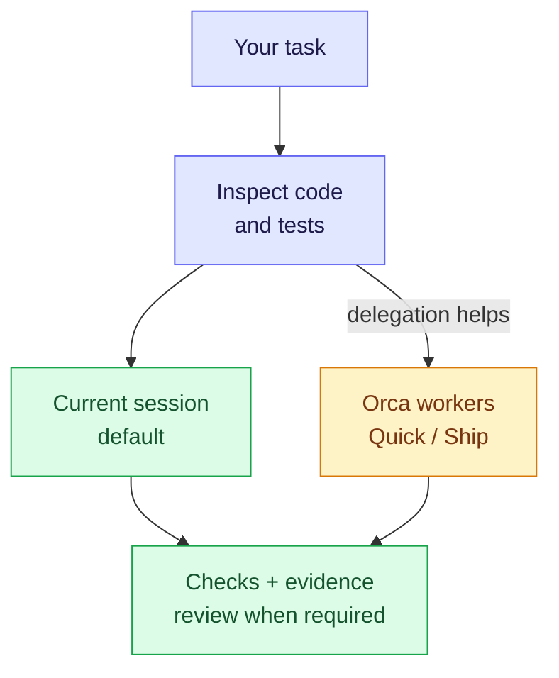
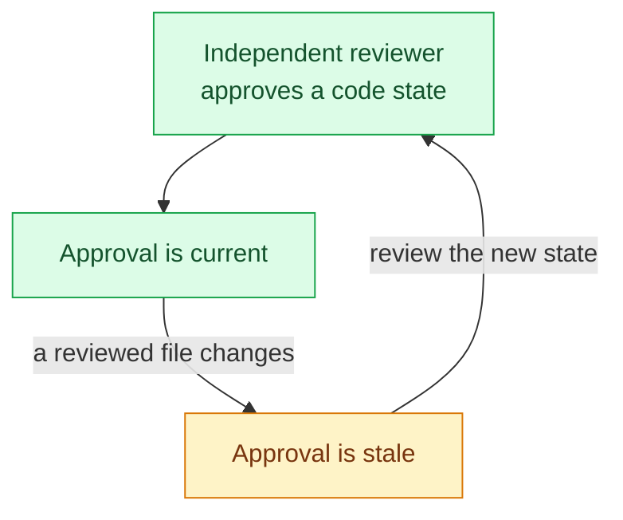

# REIN

**English** | [Español](README.es.md)

**From a coding request to a change you can verify.**

REIN gives **Claude Code and Codex** a shared method for inspecting a change,
planning when needed, checking the result, and getting independent review.
Work stays in your current session by default; **Orca** runs delegated workers
when coordination helps.

[](https://github.com/luisfarfan/rein-agentic-kit/actions/workflows/ci.yml)
[](LICENSE)
[](pyproject.toml)
[](pyproject.toml)

[See an example](#one-request-three-different-engineering-decisions) ·
[Try a check](#try-three-controls-without-starting-an-agent) ·
[Get started](#getting-started) · [Reference](docs/reference.md)



**Start with the code. Add only the process the change needs.** Discover resolves
questions that could change the solution. Plan organizes requirements and
dependencies. Audit adds an independent reviewer for sensitive changes. Quick
and Ship provide explicit delegation through Orca.

## What changes in practice

| Problem to solve | What REIN adds | What you can inspect |
| --- | --- | --- |
| A request hides existing behavior or downstream impact | Inspect code, tests, producers, and consumers before choosing a solution | Findings, remaining unknowns, and a scoped change |
| “Done” is hard to define | Tasks with acceptance criteria, dependencies, a repository, and a verification command | A plan with a check for each task |
| A check failed, or never ran | Deterministic gates separate passed checks, failed checks, and setup problems | Exit codes, command output, and gate logs |
| An approval predates the latest edits | Review verdicts are bound to hashes of reviewed files | Approval becomes stale when those files change |
| Delegated work needs coordination | Dependencies, saved run state, bounded retries, and owner decision gates | Recoverable Orca runs and visible pending questions |

## One request, three different engineering decisions

> **“Add EUR support.”**

The same request needs different work depending on the code. In the repository's
[recorded entry-policy evaluation](docs/research/2026-11-01-entry/RESULTS.md), REIN-guided
sessions inspected three development fixtures:

| What inspection found | What the session did | Why it matters |
| --- | --- | --- |
| EUR already worked; configuration disabled it | Changed the configuration and added a persistent regression test | Reused an existing capability |
| Checkout reached a ledger that only stored USD | Kept EUR disabled and added a guard; full support and independent review remained pending | Exposed a monetary invariant before claiming support |
| The actual provider contract was absent | Probed the known boundary and left real EUR support UNKNOWN | Identified the missing evidence needed to proceed |

The report includes the fixture checks and remaining work. The simple native
control also completed its change; these bounded cases demonstrate observed
behavior, without establishing general superiority over an unassisted session.

## Try three controls without starting an agent

From this checkout, with Python 3.9+, run:

```sh
python3 -m unittest -v \
  tests.test_gate_decision.DecideGateTestCase.test_nothing_ran_is_never_green \
  tests.test_gate_decision.DecideGateTestCase.test_uninvocable_test_is_setup_not_red \
  tests.test_gate.TestCheckReview.test_editing_a_reviewed_file_makes_the_approval_stale
```

**Expected: three passing tests.** They demonstrate that an empty gate cannot pass,
a missing test tool is reported as a setup problem, and an edit invalidates an
approval of the previous state. They run in temporary fixtures and require no
model turn or Orca worker.

## How review stays attached to the work



Review is required by the method for changes to security, permissions, money,
persistence, concurrency, or service contracts. A blocking finding needs a
confirmed defect and evidence. The reviewer must be independent of the implementer.
Audits can still miss defects; approval applies to the reviewed state and scope.

## What runs where

| Part | Responsibility |
| --- | --- |
| **Your Claude Code or Codex session** | Inspect the task, reason about impact, select useful skills, and normally implement locally |
| **REIN skills** | Guide investigation, planning, implementation boundaries, review, and delegation |
| **REIN CLI** | Resolve project commands, check plans, run gates, validate evidence freshness, record review state, and coordinate delegated runs |
| **Orca, when delegating** | Run workers and manage their worktrees, terminals, account observations, and decision gates |

Explicit Discover is investigation-only. Plan previews the draft before writing.
Quick delegates a small change when requested. Ship coordinates a plan when
parallel work or recovery justifies it. Answer and Watch surface decisions back
to the initiating session. [Operational details](docs/reference.md).

## Getting started

### 1. Make the skills available to your agent

For Claude Code, install from the marketplace:

```sh
claude plugin marketplace add luisfarfan/rein-agentic-kit
claude plugin install rein@rein-agentic-kit --scope project
```

To update that installation:

```sh
claude plugin marketplace update rein-agentic-kit
claude plugin update rein@rein-agentic-kit
```

You can also load the plugin directly from a local checkout:

```sh
claude --plugin-dir /absolute/path/to/rein/plugins/rein
```

For Codex, this repository exposes the same seven skills through
[`.agents/skills`](.agents/skills) and the plugin manifest. To use them in another
project, follow the [local installation and provider guide](docs/native-providers.md).
Both providers share the same core in `plugins/rein`, including the same scope,
verification, and independent-review rules.

### 2. Adopt the project entry guidance

Merge one copy of [`ENTRY.md`](plugins/rein/ENTRY.md) into the project's
`AGENTS.md`, preserving its existing instructions. For Claude, add `@AGENTS.md` to
the neighboring `CLAUDE.md` when needed. Start a fresh session in the correct
checkout or worktree and describe the task normally.

**Installing the plugin exposes the skills; adopting the guidance enables the
shared approach to ordinary tasks.** REIN does not edit those files automatically.
The guidance is an instruction to the agent. Compliance also depends on the
provider and the project's other instructions.

You can invoke a capability directly:

| Skill | Claude Code | Codex |
| --- | --- | --- |
| Investigate | `/rein:rein-discover` | `$rein:rein-discover` |
| Plan | `/rein:rein-plan` | `$rein:rein-plan` |
| Delegate a small change | `/rein:quick` | `$rein:quick` |
| Coordinate a plan | `/rein:ship` | `$rein:ship` |
| Audit | `/rein:rein-audit` | `$rein:rein-audit` |
| Answer questions | `/rein:answer` | `$rein:answer` |
| Assign a session's role | `/rein:rein-role` | `$rein:rein-role` |

Standalone installation may expose names without the prefix. Use the skill picker
to resolve ambiguity.

### 3. Use the CLI and, for delegation, Orca

The CLI requires **Python 3.9 or newer** and has no runtime dependencies.
To install from this checkout in an isolated environment:

```sh
python3 -m venv .venv
.venv/bin/pip install .
.venv/bin/rein doctor .
```

You can also run the source directly:

```sh
python3 plugins/rein/bin/rein doctor .
```

For ordinary terminals, install the CLI with `uv tool install rein-agentic-kit`
or `pipx install rein-agentic-kit`. Your project's test and build tools are
installed separately.

Quick and Ship require **Orca**, its CLI, and repositories registered there.
Ship runs inside an Orca terminal; `rein ship <change> --detach` opens that
terminal. Local checks such as `doctor`, `detect`, and `gate` work without Orca.

## Configuration and checks

REIN respects this precedence: **`flow.config.json` → project task runner → stack
detection**. It recognizes Python, Node/TypeScript, Rust, and Go, along with
frontend and infrastructure subtypes. Monorepos with multiple candidates require
an explicit subproject selection.

The [example configuration](plugins/rein/flow.config.example.json) and
[operational reference](docs/reference.md#configuration) cover commands,
per-worktree environments, execution limits, and protections.

```sh
rein doctor .                            # Inspect stack, commands, and configuration
rein gate .                              # Run checks and decide whether they pass
rein plan-check tasks.md --root . --gate  # Check a plan mechanically
rein review check                        # Check whether the review is still current
rein done my-change --native closure.json --root /plan/repo --dry-run
                                         # Preview native/multirepo closure; see docs/native-closure.md
```

`rein gate` returns `0` for a pass, `1` for a failure, and `126` when it cannot
verify the result. `rein verify` diagnoses whether commands can run: its exit code
does not certify that tests passed. See the [command reference](docs/reference.md#cli)
for flags and complete workflows.

## Evidence and current limits

The repository includes regression tests, Orca fixtures, and evaluations with
reports and traces. The [entry-policy validation](docs/research/2026-11-01-entry/RESULTS.md)
records bounded cases of native execution and selective investigation in Codex.
The [acceptance matrix](docs/research/2026-11-01-evolution/ACCEPTANCE.md) distinguishes
automated checks from real integrations and retains pending Claude and
cross-provider Quick checks.

A [comparison with native execution](docs/research/2026-11-01-followup/RESULTS.md)
produced the same functional behavior on a small task, with extra process work
when reports and routing were added. The
[planning, audit, and orchestration evaluations](docs/research/2026-10-28-post-sdd/CIERRE-PROVISIONAL-FASE2.md)
inform selective use of those layers. Available evidence does not establish a
general improvement in quality, speed, or savings.

Keep these limits in mind:

- Audits can miss defects. Approval applies to the reviewed state and scope.
- Worktree protections observe watched checkouts through Git. Ignored files and
  changes outside those repositories are outside that detection.
- Ship ends in review. Publishing, opening a PR, merging, and deploying remain
  outside its execution. `rein done --push` allows only an optional push of the
  plan-archive commit, with its own restrictions.
- Quota checks depend on usable Orca observations. REIN can resume dispatch when
  valid data arrives, but cannot guarantee that the source refreshes or that
  enough capacity remains to finish a task.

Consumption measurement remains available through `token-report`, `ledger`, and
`baseline`. Token reports read Claude Code transcripts; they are not complete
accounting for all Codex sessions. Historical studies are linked from the research
documentation.

## Documentation and development

- [Installation, providers, and project adoption](docs/native-providers.md).
- [CLI, configuration, and delegated execution reference](docs/reference.md).
- [Shared core structure](plugins/rein/README.md).
- [Project decisions](docs/decisions.md).
- [Evolution and evidence record](docs/research/2026-11-01-evolution/README.md).

Questions or bug reports: [GitHub issues](https://github.com/luisfarfan/rein-agentic-kit/issues).

Run the regression suite from the repository root:

```sh
python3 -m unittest discover -s tests -q
```

[MIT license](LICENSE).
